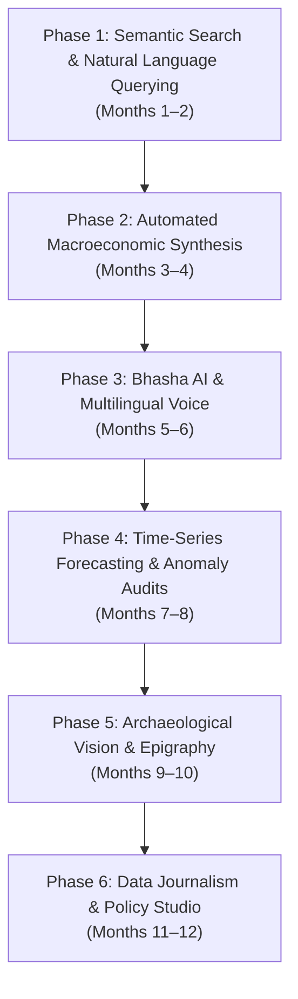
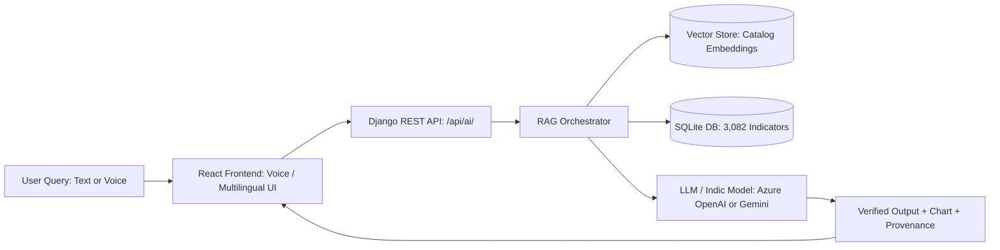

# 🇮🇳 India's Journey — Artificial Intelligence & Intelligent Analytics Roadmap

**A Phased Blueprint for Integrating Generative, Predictive, and Multilingual AI into India's Public-Data Atlas.**

---

## Executive Vision

*India's Journey* curates over **3,082 verified public indicators across 11 core categories**, spanning 75+ years of economic history, state finances, public health, elections, court efficiency, urban transit, and ancient archaeological atlases. 

The objective of this AI Roadmap is to transform the platform from a **static observational atlas** into an **interactive, intelligent analytical companion**. Citizens, researchers, students, and policymakers will be able to converse with the data in their native languages, uncover cross-domain structural patterns, and generate publication-ready policy synthesis with verified provenance.

---

## Architectural Principles & Guardrails

1. **Grounded Truth & Zero Hallucination**: AI outputs must strictly cite underlying indicator IDs, official publishers (RBI, MoSPI, NITI Aayog, ECI, NCRB), survey methodologies, and published cadence. Estimates are never blended with official figures.
2. **Cost-Effective & Serverless**: All model inferences utilize client-side embeddings or serverless API calls (Azure OpenAI / Gemini API / Bhashini), preserving the lightweight Linux B1 App Service footprint and staying well within the ₹12,500/month budget ceiling.
3. **Non-Partisan Objectivity**: Analysis remains descriptive, empirical, and contextualized with official caveats (e.g., base-year revisions, definition changes).
4. **Multilingual Inclusivity**: Ensuring parity across English and Eighth Schedule Indian languages.

---

## Phased Implementation Roadmap

---

### Phase 1: Semantic Search & Natural Language Querying (Months 1–2)
*Focus: Instant discovery across 3,082 indicators without navigating category trees.*

* **Vector Search Index**: Pre-compute dense vector embeddings (using `text-embedding-3-small`) for all indicator titles, descriptions, notes, and tags in `data/catalog.json`.
* **Zero-Shot "Ask the Atlas"**: Users type intuitive queries (e.g., *"How much rice did Punjab produce over the last decade?"* or *"Compare EV two-wheeler subsidies with charging stations"*). The engine maps the query directly to the exact indicator IDs and renders the interactive chart.
* **Smart Chart Recommendation**: When exploring an indicator, the system suggests 3 mathematically or thematically related indicators (e.g., viewing *Crude Oil Import Bill* suggests *Current Account Deficit* and *USD/INR Exchange Rate*).
* **Delivery**: Client-side vector lookup (using WebAssembly/HNSWLib) or lightweight serverless endpoint on `/api/ai/search/`.

---

### Phase 2: Automated Macroeconomic Synthesis & Policy Inflection Notes (Months 3–4)
*Focus: Instant analytical context and inflection-point explanations on charts.*

* **Structural Break & Inflection Detection**: Automated statistical algorithms detect trend breaks, turning points, and outliers (e.g., 2016 Demonetization, 2017 GST transition, 2020 COVID shock).
* **Executive Policy Briefs**: An AI synthesizer generates a concise 3-bullet takeaway on indicator cards and the Compare workbench:
  - *Growth Trajectory*: CAGR, baseline change, peak and trough values.
  - *Inflection Context*: Correlating significant shifts with known legislative, economic, or global events.
  - *Methodological Caveat*: Explicitly alerting users to base-year revisions (e.g., GDP from 2004–05 to 2011–12) or survey methodology shifts.
* **Delivery**: Dynamic synthesis card on `/explore/[category]/[indicator]` and the `/compare` view.

---

### Phase 3: Bhasha AI — Multilingual Vernacular Voice & Text (Months 5–6)
*Focus: Democratizing data access across scheduled Indian languages.*

* **Indic Localization Engine**: Pre-computed and cached translation of all 3,082 indicator titles, subgroup narratives, and methodology notes into 12 major Indian languages:
  - Hindi, Tamil, Telugu, Bengali, Marathi, Gujarati, Kannada, Malayalam, Odia, Punjabi, Assamese, and Urdu.
* **Bhashini & Speech Integration**:
  - Integration with the Government of India's **Bhashini Open Data API** and Whisper for vernacular speech-to-text.
  - Citizens can speak in regional languages (*"बिहार में 2011 से 2024 तक साक्षरता दर कैसे बदली?"*) and listen to audio synthesis of the key findings.
* **Delivery**: Regional language selector pill on the header and microphone query button in the search bar.

---

### Phase 4: Time-Series Forecasting & Anomaly Audits (Months 7–8)
*Focus: Forward projections and automated data integrity verification.*

* **Lightweight Forward Trajectories**:
  - Apply statistical and neural time-series forecasters (Prophet, TiDE, Chronos-Lite) for long-run infrastructure targets:
    - Renewable energy capacity additions (solar & wind) through 2030.
    - Highway construction pace and Capex utilization.
    - Metro network footfall and system expansion milestones.
  - Displays a clearly demarcated shaded confidence interval (50% and 90%) to distinguish projections from historical observations.
* **Automated Data Quality Audits**:
  - Scheduled CI agent checking newly published state and central tables for reporting discrepancies (e.g., impossible spikes in disposal rates or sharp divergence in tax receipts).
* **Delivery**: Toggleable "Project 3–5 Years Forward" view on supported annual series.

---

### Phase 5: Archaeological Computer Vision & Ancient Epigraphy Assistant (Months 9–10)
*Focus: Enhancing the Indus Valley Civilisation and Ancient Empires Atlases.*

* **Seal Symbol Concordance Matcher**:
  - Users can sketch or upload a photograph of an Indus Valley seal sign, Brahmi inscription, or Kharosthi character.
  - Computer vision matches the glyph against the Mahadevan and Parpola concordances, identifying sign frequency, associated artifacts, and excavation sites (Harappa, Mohenjo-daro, Rakhigarhi, Dholavira, Lothal).
* **AI Historical Trade Route Walkthroughs**:
  - Interactive geospatial guide narrating ancient Bronze Age maritime trade routes between Lothal, Dilmun (Bahrain), Magan (Oman), and Ur (Mesopotamia).
* **Delivery**: Integrated within the `/explore/indus-valley-civilisation` and `/explore/empires-of-ancient-india` interactive atlases.

---

### Phase 6: Autonomous Data Journalism & Policy Studio (Months 11–12)
*Focus: Publishing tools for journalists, think tanks, researchers, and students.*

* **One-Click Policy Brief Generator**:
  - Users select an indicator or comparison set and click **"Generate Policy Memo"**.
  - Generates a non-partisan research memo structured with:
    1. Executive Summary & Policy Relevance
    2. Empirical Findings & Longitudinal Trends
    3. Regional / Inter-State Disparities
    4. Data Provenance, Cadence & Methodological Constraints
    5. Formatted Academic Citations (APA, Chicago, Harvard, BibTeX).
* **Export Formats**: Ready-to-publish Markdown, PDF memo, and SVG chart graphics.
* **Delivery**: "Export Policy Brief" button in the Explore and Compare toolbars.

---

## Technical Architecture & Cloud Integration

* **Backend Service**: Dedicated Django endpoints under `webapp/indicators/ai/` (`/api/ai/query/`, `/api/ai/forecast/`, `/api/ai/memo/`).
* **Caching & Rate Limiting**: Redis/in-memory response caching for frequently asked macroeconomic queries to minimize token consumption and maintain sub-second response times.
* **Hosting**: Runs seamlessly inside the existing Azure Linux Web App container (`asp-indias-journey-b1`) with outbound API calls to managed AI gateways.

---

*Document version: 1.0.0*  
*Target Repository: [Shubhankart101/India-s-Journey](https://github.com/Shubhankart101/India-s-Journey)*  
*Main Live Deployment: [https://indias-journey-m5ag64.azurewebsites.net/](https://indias-journey-m5ag64.azurewebsites.net/)*
