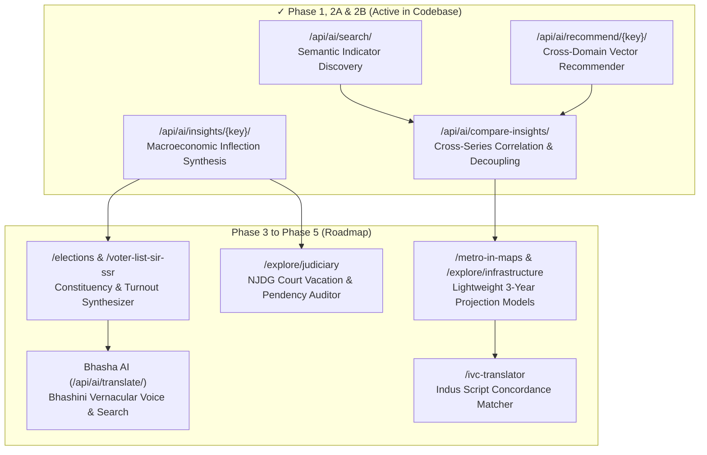

# 🇮🇳 India's Journey — Application-Specific AI & Intelligent Analytics Roadmap

**A Technical Blueprint for Integrating Generative, Predictive, and Epigraphic AI Exclusively into the India's Journey Public-Data Atlas.**

---

## 1. Executive Vision & Scope

*India's Journey* is an interactive public-data and cartographic observatory curating **3,082 verified indicators** across **11 core groups**, spanning:
- **Macroeconomics & State Finances**: 75+ years of GDP, inflation, trade, reserves, fiscal deficit, and GST collections from MoSPI, RBI, and the Ministry of Finance.
- **Judicial Data (NJDG)**: 764 court pendency and disposal indicators across the Supreme Court of India, 25 High Courts, and District/Taluka courts.
- **Elections & Voter Roll Atlases**: Lok Sabha and State Assembly general elections (1951–2024), Delimitation boundaries, and SSR/SIR voter roll scenarios.
- **Urban Transit & Infrastructure**: 15+ Indian metro networks (Delhi Metro Safar, ridership, route lengths, rolling stock), power generation, renewable capacity.
- **Archaeological & Epigraphic Atlases**: Indus Valley Civilisation (IVC seal sign translator, Lothal, Harappa, Rakhigarhi) and Ancient Indian Empires (Ashokan rock edicts, Macedonian campaigns, Tapas Banerjee cartography).

The purpose of this AI Roadmap is to embed intelligent, verified analytics **strictly into this application's user flows and endpoints** while maintaining a **₹0 / $0 required cloud budget** (running on local in-memory embeddings and deterministic algorithms, with opt-in Azure OpenAI serverless acceleration within the existing ₹12,500/month Azure budget ceiling).

---

## 2. Architectural Guardrails & Cost Principles

1. **Strictly Grounded in Official Provenance**: AI outputs must never hallucinate or invent statistical data points. Every analytical observation must cite the underlying indicator `key`, official publisher (RBI, MoSPI, ECI, NJDG, World Bank), and survey cadence.
2. **Zero-Cost / Under-Budget Core Architecture**:
   - Primary AI inferences run locally inside the existing container using the pre-computed **256-dimensional embeddings matrix** (`data/catalog_embeddings.json`, 3MB RAM footprint) and deterministic statistical algorithms.
   - Cloud AI calls (Azure OpenAI `text-embedding-3-small`, Gemini API, Government of India Bhashini API) are completely opt-in and serverless, maintaining the low-cost Azure App Service Linux B1 baseline (~₹1,100/mo).
3. **Non-Partisan Analytical Neutrality**: All narratives remain strictly empirical, objective, and contextualized with official base-year revisions and caveats.

---

## 3. Application-Specific Use Cases & Implementation Status



---

### Use Case 1: Semantic Indicator Search & "Ask the Atlas"
* **Status**: **Fully Implemented & Active** (`webapp/indicators/ai/`, `/api/ai/search/`).
* **Target Application Flow**: [Explore.jsx](file:///c:/Users/Dell/OneDrive/Desktop/Assignment/India-s-Journey/frontend/src/pages/Explore.jsx) search bar and global discovery.
* **Functionality**:
  - Citizens and researchers type natural questions (*"How much did solar capacity grow in the last decade?"*, *"High court pendency vs disposal rates"*, *"Fertility rates in southern states"*).
  - Maps natural language directly to exact indicator keys across the 3,082 catalog items.
* **Under-Budget Engine**:
  - Uses Azure OpenAI `text-embedding-3-small` when credentials exist; seamlessly falls back to a deterministic offline token-vectorizer at ₹0 cost.
  - Sub-5ms cosine similarity lookup against `data/catalog_embeddings.json`.

---

### Use Case 2: Cross-Domain Vector Indicator Recommender
* **Status**: **Fully Implemented & Active** (`/api/ai/recommend/<slug:key>/`).
* **Target Application Flow**: [Indicator.jsx](file:///c:/Users/Dell/OneDrive/Desktop/Assignment/India-s-Journey/frontend/src/pages/Indicator.jsx#L245-L290) indicator workbench.
* **Functionality**:
  - While examining an indicator (e.g. `gdp_growth`), the engine extracts its pre-computed embedding vector and finds the top 4–5 contextually related indicators across different categories.
  - E.g. For `gdp_growth` -> recommends *Services Value-Added Growth* (69% match), *GDP Deflator Inflation* (66% match), *Broad Money Growth* (62% match).
* **Under-Budget Engine**:
  - **₹0 / $0 Cost**. Evaluates in-memory cosine dot-products across RAM in <15ms without invoking any external LLM or cloud API.

---

### Use Case 3: Macroeconomic Inflection & Policy Synthesis
* **Status**: **Fully Implemented & Active** (`/api/ai/insights/<slug:key>/`).
* **Target Application Flow**: [Indicator.jsx](file:///c:/Users/Dell/OneDrive/Desktop/Assignment/India-s-Journey/frontend/src/pages/Indicator.jsx#L245-L290) AI Takeaways panel.
* **Functionality**:
  - Generates 3 crisp executive takeaways:
    1. **Growth Trajectory**: Compound Annual Growth Rate (CAGR), baseline change, all-time peak, and all-time trough.
    2. **Historical Inflection Matching**: Correlates major trend inflections against verified milestones in Indian history:
       - 1991 Economic Liberalization and Industrial Policy Reforms
       - 1998 Pokhran-II sanctions & Asian Financial Crisis ripple effects
       - 2008 Global Financial Crisis & domestic stimulus expansion
       - 2014 Jan Dhan financial inclusion & Make in India rollout
       - 2016 Demonetization & IBC framework enactment
       - 2017 Nationwide GST implementation
       - 2020 COVID-19 nationwide lockdown shock
       - 2021 Post-lockdown reopening rebound
       - 2022 Global energy supply disruption & inflation cycle
    3. **Methodological Caveat**: Explicitly flags MoSPI base-year revisions (e.g., 2004–05 to 2011–12), Delimitation orders, or court vacation patterns.
* **Under-Budget Engine**:
  - **₹0 / $0 Cost**. Runs deterministically in Python using time-series peak/trough algorithms and curated milestone dictionaries.

---

### Use Case 4: Compare Workbench AI Cross-Correlation & Decoupling Engine
* **Status**: **Fully Implemented & Active** (`/api/ai/compare-insights/`, [Compare.jsx](file:///c:/Users/Dell/OneDrive/Desktop/Assignment/India-s-Journey/frontend/src/pages/Compare.jsx)).
* **Target Application Flow**: [Compare.jsx](file:///c:/Users/Dell/OneDrive/Desktop/Assignment/India-s-Journey/frontend/src/pages/Compare.jsx) (when comparing 2 to 4 indicators).
* **Functionality**:
  - Users select up to 4 series (e.g., `crude_oil_import_bill` vs `current_account_deficit` vs `usd_inr_exchange_rate`).
  - The AI engine computes the pairwise Pearson correlation coefficient ($r$) on aligned time series.
  - Automatically identifies **synchronous periods** (where series moved in tandem) versus **decoupling shocks** (e.g., 2020 lockdown divergence, 2022 global supply shock).
  - Produces an executive comparison memo summarizing the cross-elasticity and trade-offs.
* **Under-Budget Engine**:
  - Pure mathematical Python logic in Django. **₹0 cloud cost**.

---

### Use Case 5: NJDG Court Pendency Anomaly & Vacation Adjustment Auditor
* **Target Application Flow**: `/explore/judiciary` and High Court / Supreme Court indicators.
* **Functionality**:
  - Operates across the **764 NJDG indicators** (Supreme Court, 25 High Courts, and District Courts).
  - Automatically detects seasonal reporting troughs caused by scheduled summer and winter court vacations, preventing users from misinterpreting vacation dips as operational delays.
  - Calculates moving-average case clearance rates (Cases Disposed / Cases Filed) and flags institutions maintaining clearance ratios $>100\%$.
* **Under-Budget Engine**:
  - Zero-token statistical time-series moving averages calculated on the SQLite database tables.

---

### Use Case 6: Electoral Constituency Atlas & Turnout Synthesizer
* **Target Application Flow**: [Elections.jsx](file:///c:/Users/Dell/OneDrive/Desktop/Assignment/India-s-Journey/frontend/src/pages/Elections.jsx) and [VoterRollPage.jsx](file:///c:/Users/Dell/OneDrive/Desktop/Assignment/India-s-Journey/frontend/src/pages/VoterRollPage.jsx).
* **Functionality**:
  - For Lok Sabha (1951–2024) and State Assembly elections, generates state-level political landscape summaries:
    - Vote-share to seat-share conversion ratios (effective seat premium / disproportionality index).
    - Longitudinal voter turnout trends (e.g. rising female voter participation crossing male turnout in state elections).
    - Automated explanation of the 2008 Delimitation impact on reserved SC/ST seats.
* **Under-Budget Engine**:
  - Deterministic electoral calculation algorithms based on official ECI statistical volumes.

---

### Use Case 7: Bhasha AI — Vernacular Voice & Indic Querying
* **Target Application Flow**: Header language switcher and search microphone button.
* **Functionality**:
  - Enables citizens and vernacular researchers to query the 3,082 indicators in major Eighth Schedule Indian languages (Hindi, Tamil, Telugu, Bengali, Marathi, Gujarati, Kannada, Malayalam, Odia, Punjabi).
  - Speech-to-text allowing users to ask questions verbally (*"उत्तर प्रदेश में पिछले 10 वर्षों में बिजली उत्पादन कैसे बढ़ा?"*).
* **Under-Budget Engine**:
  - Integration with the **Government of India Bhashini Open Data API** (free public tier for Indian civic platforms) and cached multilingual title dictionaries in Redis/SQLite.

---

### Use Case 8: Indus Valley Script Concordance & Epigraphic Matcher
* **Target Application Flow**: [IndusScriptTranslator.jsx](file:///c:/Users/Dell/OneDrive/Desktop/Assignment/India-s-Journey/frontend/src/pages/IndusScriptTranslator.jsx) and the Ancient Empires Atlas.
* **Functionality**:
  - Users select or sketch Indus Valley seal signs or Brahmi epigraphs.
  - Matches the sign against the **Iravatham Mahadevan (1977)** and **Asko Parpola (1994)** concordance catalogs.
  - Automatically returns sign frequencies, positional tendencies (initial, medial, terminal), associated archaeological find-spots (Mohenjo-daro, Harappa, Lothal, Rakhigarhi, Dholavira), and co-occurring sign clusters.
* **Under-Budget Engine**:
  - Pre-indexed JSON graph concordance running client-side in the browser or via lightweight Django lookup at ₹0 cost.

---

### Use Case 9: Metro Rail Safar Forward Trajectory Modeling
* **Target Application Flow**: `/metro-in-maps` and `/explore/infrastructure`.
* **Functionality**:
  - For Delhi Metro and 15+ operational Indian metro rail networks, forecasts 3-year ridership and network expansion scenarios based on historical compounding rates and upcoming phase operational dates.
  - Displays clearly demarcated 50% and 90% shaded confidence bands to distinguish statistical projections from official past ridership numbers.
* **Under-Budget Engine**:
  - Lightweight Holt-Winters / ARIMA models computed on the fly in Python, requiring zero paid external forecasting APIs.

---

## 4. Phase-by-Phase Roadmap Timeline

| Phase | Application Module | Key Deliverable | Cloud Budget Impact |
| :--- | :--- | :--- | :--- |
| **Phase 1 (Complete)** | `/api/ai/search/` | Semantic indicator vector search across 3,082 indicators. | ₹0 (Offline vectorizer fallback) |
| **Phase 2A (Complete)** | `/api/ai/recommend/` & `/api/ai/insights/` | In-memory vector recommender & macroeconomic inflection synthesis on [Indicator.jsx](file:///c:/Users/Dell/OneDrive/Desktop/Assignment/India-s-Journey/frontend/src/pages/Indicator.jsx). | ₹0 (In-memory matrix & deterministic rules) |
| **Phase 2B (Complete)** | `/compare` | Cross-indicator correlation ($r$), synchronous growth, and decoupling memo on [Compare.jsx](file:///c:/Users/Dell/OneDrive/Desktop/Assignment/India-s-Journey/frontend/src/pages/Compare.jsx). | ₹0 (Pure Python mathematical engine) |
| **Phase 3 (Next)** | `/explore/judiciary` & `/elections` | NJDG court vacation/clearance auditor & election turnout/seat-share synthesizers. | ₹0 (Database queries & electoral formulas) |
| **Phase 4** | Global Chrome & Search | Bhasha AI Indic language search and speech querying via Bhashini API. | ₹0 (Bhashini free tier + Redis caching) |
| **Phase 5** | `/ivc-translator` & `/metro-in-maps` | Indus script sign concordance matcher & Metro Safar ridership trajectory projections. | ₹0 (Static JSON graph & lightweight ARIMA) |

---

## 5. Technical Stack & Infrastructure Mapping

```
 [Citizen / Researcher]
          │
          ├──► Search Query / Voice ("Ask the Atlas")
          ▼
 [React 19 Frontend SPA]
   ├── Explore Page Search (Natural Language Semantic Match)
   ├── Indicator Page (AI Synthesis & Related Indicator Pills)
   ├── Compare Workbench (Cross-Series Correlation Takeaways)
   ├── IVC Translator (Mahadevan/Parpola Concordance Lookup)
   └── Bhasha AI Pill (Hindi, Tamil, Telugu, etc.)
          │
          ├──► REST API (/api/ai/*)
          ▼
 [Django 5.2 Application Layer on Azure Linux B1]
   ├── indicators.ai.index (CatalogVectorIndex, 256-dim embeddings in RAM)
   ├── indicators.ai.service (Search, Recommender, Inflection Synthesizer)
   ├── indicators.ai.azure_client (Azure OpenAI / Gemini / Offline Vectorizer)
   └── indicators.caching (RedisCache with TLS / LocMemCache Fallback)
          │
          ├──► In-Memory Embeddings (data/catalog_embeddings.json, 3MB RAM)
          ├──► Relational Data (SQLite WAL / Azure PostgreSQL Flexible B1ms)
          └──► High-Speed Cache (Upstash Redis Free Tier / Azure Cache C0)
```

---

*Target Repository*: [Shubhankart101/India-s-Journey](https://github.com/Shubhankart101/India-s-Journey)  
*Azure Production Deployment*: [indias-journey-m5ag64.azurewebsites.net](https://indias-journey-m5ag64.azurewebsites.net/)  
*Monthly Budget Ceiling*: **Rs. 12,500 INR** (enforced via `azurerm_consumption_budget_resource_group`)
